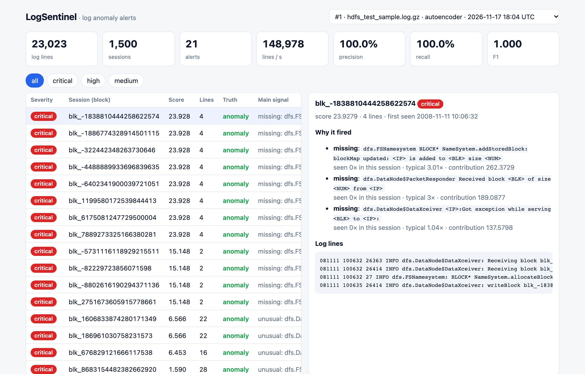
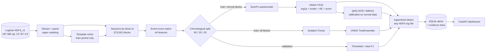

# LogSentinel

[](https://github.com/RobiiAragon/logsentinel/actions/workflows/ci.yml)


[English](README.md) · **Español**

**Detección de anomalías en logs para un SOC, desde las líneas crudas hasta un panel de
alertas.** Convierte 11.2 millones de líneas de logs de HDFS en plantillas de eventos, las
agrupa en sesiones y califica cada sesión con un Isolation Forest y un autoencoder chico.
Ambos corren como modelos **ONNX** (FP32, INT8, W8A16), así que el mismo detector funciona en
una laptop, un dispositivo Snapdragon o una tablet Android. Cada alerta explica *qué eventos
faltaron o fueron inusuales*.



- **Parsing a 190k líneas/s:** enmascarado con regex + un minero de plantillas estilo Drain que
  solo procesa los strings únicos (66 en lugar de 11.2M) y produce 43 plantillas. Las plantillas
  se aprenden solo del periodo de entrenamiento; lo nuevo en test se vuelve `<UNKNOWN TEMPLATE>`.
- **Modelos:** Isolation Forest (exportado con skl2onnx) y un autoencoder 44→32→8→32→44
  **escrito en NumPy y convertido a grafo ONNX a mano**. El preprocesamiento (log1p,
  estandarización) y el score (error de reconstrucción + error por plantilla para las
  explicaciones) van *dentro* del grafo, así que los dispositivos solo necesitan ONNX Runtime y
  NumPy.
- **Estudio de cuantización:** QDQ INT8 (W8A8) y W8A16, incluyendo un error de calibración que
  encontré y corregí (ver resultados).
- **Evaluación honesta:** split cronológico 60/20/20 por bloque (entrenar con el pasado y
  probar con el futuro). Los umbrales se eligen en validación y precision/recall/F1/PR-AUC/ROC-AUC
  se reportan sobre un test que los modelos nunca vieron.
- **Panel para el SOC:** FastAPI + UI de una sola página sobre SQLite, con severidad, verdad de
  terreno (si hay etiquetas), las plantillas que dispararon la alerta y las líneas crudas de
  cada sesión.
- **En el dispositivo:** ONNX Runtime con detección de EPs (CPU, CoreML, QNN, CUDA, NNAPI,
  XNNPACK). El detector corre en Termux sin scikit-learn.

## Pipeline




## Inicio rápido

Los modelos entrenados (~460 KB) y una muestra de test de 1,500 sesiones (280 KB) vienen en el
repo, así que la detección funciona justo después de clonar:

```bash
git clone https://github.com/RobiiAragon/logsentinel && cd logsentinel
python3.12 -m venv .venv && source .venv/bin/activate
pip install -e ".[dev]"

logsentinel detect data/sample/hdfs_test_sample.log.gz \
    --labels data/sample/hdfs_test_sample_labels.csv          # -> alerts.db
logsentinel serve                                             # http://127.0.0.1:8000
```

Para reproducir todo desde los datos crudos (≈ 2.5 min en un M5 Max):

```bash
logsentinel prepare      # descarga HDFS_v1 (187 MB, SHA-256 verificado) y parsea 11.2M líneas
logsentinel train        # Isolation Forest + autoencoder -> ONNX FP32 / INT8 / W8A16
logsentinel evaluate --out results/mi-equipo.json
```

Otros comandos: `detect --threshold X` cambia el umbral elegido en validación (súbelo para
recibir menos alertas), `export` saca las alertas de una corrida como **NDJSON con campos
ECS** (Elastic Common Schema) o CSV para un SIEM, y `card` regenera
[`MODEL_CARD.md`](MODEL_CARD.md) a partir de `models/` y un archivo de resultados.

## Resultados medidos en mi Mac

**Hardware:** MacBook Pro (Mac17,6), Apple **M5 Max**, 48 GB RAM, macOS 27.2.
**Software:** Python 3.12.16, onnxruntime 1.32.0, scikit-learn 1.9.1, skl2onnx 1.20.0.
**Datos:** Loghub HDFS_v1: 11,175,629 líneas, 575,061 bloques (2.93% anómalos). El **test
cronológico tiene 115,013 bloques, 1,679 anómalos (1.46%)**. La [model card](MODEL_CARD.md) generada
tiene las mismas métricas en formato de Hugging Face.

### Calidad de detección (test, umbral elegido en validación)

| Modelo | Etiquetas necesarias | Precision | Recall | F1 | PR-AUC | TP / FP / FN | Tamaño |
|---|---|---:|---:|---:|---:|---:|---:|
| Isolation Forest | ninguna | 0.364 | 0.913 | 0.521 | 0.765 | 1533 / 2673 / 146 | 423 KB |
| Autoencoder entrenado con todo el train | ninguna | 0.385 | 1.000 | 0.556 | 0.477 | 1679 / 2679 / 0 | (no exportado) |
| **Autoencoder FP32** entrenado con bloques normales | etiquetas "normal" del periodo de entrenamiento (one-class) | **0.955** | **0.997** | **0.976** | **0.998** | 1674 / 78 / 5 | 14.6 KB |
| Autoencoder **INT8** (W8A8 QDQ) | ″ | 0.924 | 0.997 | 0.959 | 0.996 | 1674 / 137 / 5 | 10.6 KB |
| Autoencoder **W8A16** (QDQ) | ″ | 0.955 | 0.997 | 0.976 | 0.997 | 1674 / 79 / 5 | 11.0 KB |
| Regresión logística (referencia supervisada) | todos los bloques etiquetados | 0.955 | 0.992 | 0.973 | 0.990 | 1665 / 79 / 14 | n/a |

CPU y CoreML dan detecciones idénticas en todos los modelos; solo cambia la velocidad.

### Velocidad (M5 Max, EP CPU)

| Etapa | Resultado |
|---|---:|
| Parsing + sesiones (log completo) | 188–192k líneas/s (11.2M líneas en ~59 s) |
| `detect` de punta a punta (parsing, score, SQLite, evidencia) | ~150–170k líneas/s |
| Solo el score del autoencoder, batch 4096 | ~17M sesiones/s (FP32) |
| Latencia del autoencoder, batch 1 | 0.007 ms p50 |
| Latencia del Isolation Forest, batch 1 | 0.35 ms p50 |
| Entrenamiento (autoencoder / Isolation Forest) | 0.9 s / 0.5 s |

El score prácticamente no cuesta; **el cuello de botella es el parsing**. CoreML es más lento
que la CPU para modelos tan chicos (0.084 vs 0.007 ms en el autoencoder; el operador
TreeEnsemble no está soportado y cae a CPU), porque el overhead de despacho domina cuando el
modelo tiene 4 capas.

### Lo que aprendí

1. **Saber cómo se ve lo "normal" importa más que el algoritmo.** El mismo autoencoder pasa de
   F1 0.556 (entrenado con todo, incluyendo 3% de anomalías) a **0.976** cuando se entrena solo
   con bloques del periodo de entrenamiento etiquetados como normales. Eso iguala a una
   regresión logística totalmente supervisada (F1 0.973). Para ser exactos: las etiquetas de
   entrenamiento se usaron para *quitar* los bloques anómalos, así que es un modelo one-class,
   no uno sin etiquetas. En producción el equivalente es un periodo base que un operador
   revisó como sano; para detectar no se necesitan etiquetas.
2. **Isolation Forest batalla con vectores de conteos:** 91% de recall pero 2,673 falsos
   positivos contra 1,533 detecciones correctas (1.7 falsas alarmas por anomalía real),
   demasiado ruido para la cola de un SOC.
3. **El error de cuantización: calibrar con la distribución de entrenamiento.** Mi primer
   modelo INT8 colapsó (F1 de validación 0.985 → 0.563). Calibrar con una mezcla aleatoria del
   train incluye sesiones anómalas con activaciones enormes que estiran los rangos de 8 bits.
   El ruido de cuantización subió el score de las sesiones *normales* de ~0.000 a ~1.84, por
   encima de la anomalía típica (0.575). Percentile y entropy no ayudaron. **Calibrar con
   sesiones normales**, los mismos datos con los que se entrenó, lo arregló (0.563 → 0.975; 0.994
   en el modelo final). W8A16 es robusto en ambos casos.
4. **Piso de varianza.** 37 de las 44 plantillas (casi) nunca aparecen en sesiones normales,
   así que su std es ~0 y una sola aparición dispara el z-score (scores de hasta 279,836). Un
   piso de 0.1, elegido en validación entre {0.001, 0.05, 0.1, 0.25, 0.5}, acota los scores
   (máx. 41), estabiliza las explicaciones y subió el PR-AUC de validación de 0.995 a 0.999.
5. **Explicaciones legibles para un analista:** el error por plantilla en la salida del ONNX
   permite decir *"falta: `addStoredBlock … blockMap updated` (visto 0×, típico 3×)"*, que es la
   firma real de una escritura en HDFS que nunca terminó.

Todas las decisiones de diseño se tomaron con validación y el test se evaluó al final. La
muestra de 1,500 bloques da F1 1.000 con el autoencoder, pero solo tiene 21 anomalías; los
números que valen son los del test completo.

## Correrlo en la Galaxy Tab S9 Ultra (Termux)

```bash
pkg install -y git
git clone https://github.com/RobiiAragon/logsentinel && cd logsentinel
bash scripts/android_termux_check.sh          # ~1 min: muestra, todos los modelos, CPU/XNNPACK/NNAPI
FULL=1 bash scripts/android_termux_check.sh   # + descarga 187 MB, parsea 11.2M líneas, evaluación completa
```

Instala NumPy y ONNX Runtime precompilados de Termux (no necesita scikit-learn ni PyTorch
porque todos los modelos son ONNX) y reporta líneas/s y precision/recall/F1 por modelo y EP.
Los resultados quedan en `results/android-<modelo>.db/.json`. El panel no se instala en Termux
(`pydantic-core` no tiene wheel para Android): copia el `.db` a una laptop y corre
`logsentinel serve --db …`.

## Desarrollo

```bash
pip install -e ".[dev]"
ruff check . && ruff format --check . && pytest -q   # 17 pruebas, ~3 s
scripts/mac_check.sh                                  # pipeline completo + eval + panel
QUICK=1 scripts/mac_check.sh                          # solo los modelos del repo
```

## Roadmap

- [ ] Resultados de la tablet (Snapdragon 8 Gen 2: CPU / XNNPACK / NNAPI)
- [ ] BGL (Blue Gene/L) con ventanas deslizantes para logs sin id de sesión
- [ ] Modelo de secuencias (GRU chico / estilo DeepLog) exportado a ONNX
- [ ] Modo streaming: seguir un log en vivo y mandar alertas por WebSocket
- [ ] Logs de SSH (Loghub `SSH`) como demo de seguridad: fuerza bruta y credential stuffing
- [x] Exportar alertas como NDJSON ECS / CSV para un SIEM (`logsentinel export`)
- [ ] Reglas Sigma para las firmas de alerta más comunes

## Datos y licencia

Código: MIT © Jesús Aragón. Datos: **Loghub HDFS_v1, CC BY 4.0** (Zenodo 8196385); la muestra
de `data/sample/` es un subconjunto redistribuido bajo la misma licencia. Cita a Xu et al.
(SOSP 2009) y a Zhu et al., *Loghub* (ISSRE 2023).
