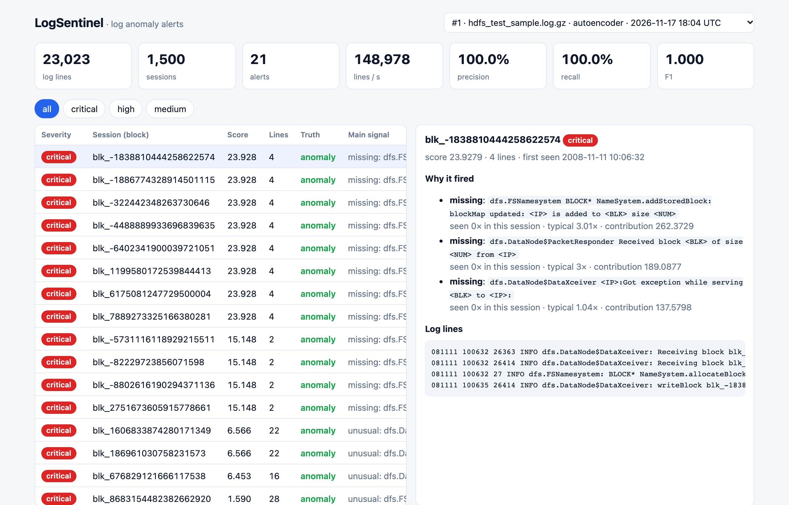
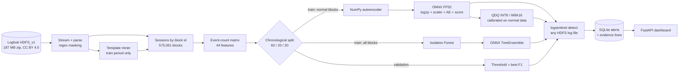

# LogSentinel

[](https://github.com/RobiiAragon/logsentinel/actions/workflows/ci.yml)


**English** · [Español](README.es.md)

**Log anomaly detection for a SOC, from raw log lines to an alert dashboard.** It parses
11.2 million HDFS log lines into event templates, groups them into sessions, and scores each
session with an Isolation Forest and a small autoencoder. Both run as **ONNX** models
(FP32, INT8, W8A16), so the same detector runs on a laptop, a Snapdragon device or an
Android tablet. Every alert explains *which events were missing or unusual*.



- **Parsing at 190k lines/s:** regex masking plus a Drain-style template miner that runs only
  on unique masked strings (66 instead of 11.2M), giving 43 templates. Templates are mined from
  the training period only; anything new at test time becomes an `<UNKNOWN TEMPLATE>` feature.
- **Models:** Isolation Forest (exported with skl2onnx) and a 44→32→8→32→44 autoencoder
  **written in NumPy and emitted as an ONNX graph by hand**. Preprocessing (log1p,
  standardization) and the score (reconstruction error, plus per-template error for
  explanations) are *inside* the graph, so devices need only ONNX Runtime and NumPy.
- **Quantization study:** static QDQ INT8 (W8A8) and W8A16, including a calibration pitfall
  I hit and fixed (see results).
- **Honest evaluation:** a chronological 60/20/20 split by block (train on the past, test on
  the future), thresholds picked on validation, and precision/recall/F1/PR-AUC/ROC-AUC
  reported on a test set the models never saw.
- **SOC dashboard:** FastAPI plus a single-page UI over SQLite: alert severity, ground truth
  when labels exist, the "why it fired" templates, and the raw log lines of each session.
- **On-device:** ONNX Runtime with EP detection (CPU, CoreML, QNN, CUDA, NNAPI, XNNPACK). The
  detector runs in Termux on Android with no scikit-learn.

## Pipeline



## Quickstart

The trained models (~460 KB) and a 1,500-session test sample (280 KB) are committed, so
detection works right after cloning:

```bash
git clone https://github.com/RobiiAragon/logsentinel && cd logsentinel
python3.12 -m venv .venv && source .venv/bin/activate
pip install -e ".[dev]"

logsentinel detect data/sample/hdfs_test_sample.log.gz \
    --labels data/sample/hdfs_test_sample_labels.csv          # -> alerts.db
logsentinel serve                                             # http://127.0.0.1:8000
```

Reproduce everything from the raw data (≈ 2.5 min on an M5 Max):

```bash
logsentinel prepare      # download HDFS_v1 (187 MB, SHA-256 checked), parse 11.2M lines
logsentinel train        # Isolation Forest + autoencoder -> ONNX FP32 / INT8 / W8A16
logsentinel evaluate --out results/my-machine.json   # test split, every model x EP
```

| Command | Purpose |
|---|---|
| `prepare` | Download, parse, mine templates, build session features and the demo sample |
| `train` | Train the models, choose thresholds on validation, export and quantize to ONNX |
| `evaluate` | Test-split metrics, throughput and batch-1 latency per model and EP |
| `detect LOG` | Score any HDFS-format `.log`/`.log.gz` and store alerts and evidence in SQLite (`--threshold` overrides the validation threshold) |
| `serve` | Alert dashboard (`--db alerts.db`) |
| `export` | A run's alerts as **ECS NDJSON** (Elastic Common Schema field names) or CSV, for a SIEM (`--format ecs\|csv`, `--severity`, `-o`) |
| `card` | Regenerate [`MODEL_CARD.md`](MODEL_CARD.md) from `models/` and a results file |
| `providers` | Available / skipped ONNX Runtime execution providers |

## Results: measured on my Mac

**Hardware:** MacBook Pro (Mac17,6), Apple **M5 Max**, 48 GB RAM, macOS 27.2.
**Software:** Python 3.12.16, onnxruntime 1.32.0, scikit-learn 1.9.1, skl2onnx 1.20.0.
**Data:** Loghub HDFS_v1, 11,175,629 lines and 575,061 blocks (2.93% anomalous). The
chronological **test split has 115,013 blocks, 1,679 of them anomalous (1.46%)**. Raw data:
[`results/mac-m5max.json`](results/mac-m5max.json),
[`models/train_report.json`](models/train_report.json), and the generated
[model card](MODEL_CARD.md) with a Hugging Face-style metrics block.

### Detection quality (test split, threshold chosen on validation)

| Model | Labels needed | Precision | Recall | F1 | PR-AUC | TP / FP / FN | Size |
|---|---|---:|---:|---:|---:|---:|---:|
| Isolation Forest | none | 0.364 | 0.913 | 0.521 | 0.765 | 1533 / 2673 / 146 | 423 KB |
| Autoencoder, trained on all train blocks | none | 0.385 | 1.000 | 0.556 | 0.477 | 1679 / 2679 / 0 | (not exported) |
| **Autoencoder FP32**, trained on normal train blocks | normal labels of the train period (one-class) | **0.955** | **0.997** | **0.976** | **0.998** | 1674 / 78 / 5 | 14.6 KB |
| Autoencoder **INT8** (W8A8 QDQ) | ″ | 0.924 | 0.997 | 0.959 | 0.996 | 1674 / 137 / 5 | 10.6 KB |
| Autoencoder **W8A16** (QDQ) | ″ | 0.955 | 0.997 | 0.976 | 0.997 | 1674 / 79 / 5 | 11.0 KB |
| Logistic regression (supervised reference) | every block labeled | 0.955 | 0.992 | 0.973 | 0.990 | 1665 / 79 / 14 | n/a |

CPU and CoreML give identical detections for every model; only the speed differs.

### Speed

| Stage | M5 Max, CPU EP |
|---|---:|
| Parse + sessionize (`prepare`, full log) | 188–192k lines/s (11.2M lines in ~59 s) |
| End-to-end `detect` (parse, score, SQLite, evidence) | ~150–170k lines/s |
| Autoencoder scoring alone, batch 4096 | ~17M sessions/s (FP32) |
| Autoencoder latency, batch 1 | 0.007 ms p50 |
| Isolation Forest latency, batch 1 | 0.35 ms p50 |
| Training (autoencoder / Isolation Forest) | 0.9 s / 0.5 s |

Scoring is effectively free; **parsing is the bottleneck**. CoreML is slower than CPU for
these tiny models (0.084 ms vs 0.007 ms for the autoencoder at batch 1; the TreeEnsemble op
isn't supported, so it falls back): dispatch overhead dominates when the model has 4 layers.

### What I learned

1. **Knowing what "normal" looks like matters more than the algorithm.** The same autoencoder
   goes from F1 0.556 (trained on everything, 3% anomalies included) to **0.976** when trained
   only on train-period blocks labelled normal. That matches a fully supervised logistic
   regression (F1 0.973). To be precise: the training labels were used to *remove* the
   anomalous blocks, so this is a one-class model, not a label-free one. In production the
   equivalent is a baseline period an operator has vetted as healthy; scoring needs no labels.
2. **Isolation Forest struggles on count vectors.** It reaches 91% recall, but with 2,673 false
   positives for 1,533 true detections (1.7 false alarms per real anomaly), which is too noisy
   for a SOC queue.
3. **The quantization pitfall: calibrate on the training distribution.** My first INT8 model
   collapsed (validation F1 0.985 → 0.563). Calibrating with a random mix of train blocks
   includes anomalous sessions whose huge activations stretch every 8-bit range. That made
   quantization noise lift *normal* sessions' scores from ~0.000 to ~1.84, above the typical
   anomaly (0.575). Percentile and entropy calibration didn't help (val F1 0.563). **Calibrating
   on normal sessions**, the data the model was trained on, fixed it (val F1 0.563 → 0.975, and
   0.994 in the final model). W8A16 is robust either way.
4. **Variance floor.** 37 of the 44 templates (almost) never occur in normal sessions, so their
   std is ~0 and one occurrence explodes the z-score (scores up to 279,836). A std floor of 0.1,
   chosen on validation from {0.001, 0.05, 0.1, 0.25, 0.5}, bounds scores (max 41), stabilizes
   explanations and raised validation PR-AUC from 0.995 to 0.999.
5. **Explanations SOC analysts can read.** Per-template reconstruction error in the ONNX
   output lets the dashboard say *"missing: `addStoredBlock … blockMap updated` (seen 0×,
   typical 3×)"*, which is the actual signature of an HDFS write that never completed.

Evaluated once on the test split after the design choices above were made on validation.
The 1,500-block sample in `data/sample/` gets F1 1.000 with the autoencoder, but it has only
21 anomalies: use the full test split numbers above.

## Run it on the Galaxy Tab S9 Ultra (Termux)

```bash
pkg install -y git
git clone https://github.com/RobiiAragon/logsentinel && cd logsentinel
bash scripts/android_termux_check.sh          # ~1 min: sample, all models, CPU/XNNPACK/NNAPI
FULL=1 bash scripts/android_termux_check.sh   # + download 187 MB, parse 11.2M lines, full test eval
```

It installs Termux's prebuilt NumPy and ONNX Runtime (no scikit-learn or PyTorch needed:
every model is plain ONNX), then reports lines/s and precision/recall/F1 per model and EP.
Results land in `results/android-<model>.db/.json`. The FastAPI dashboard isn't installed on
Termux (`pydantic-core` has no Android wheel); copy the `.db` to a laptop and run
`logsentinel serve --db …`.

## Development

```bash
pip install -e ".[dev]"
ruff check . && ruff format --check . && pytest -q   # 17 tests, ~3 s
scripts/mac_check.sh                                  # full pipeline + eval + dashboard smoke test
QUICK=1 scripts/mac_check.sh                          # committed models only
```

The tests use synthetic HDFS-format logs (normal write pipelines vs. pipelines that stop and
throw), check that the hand-built ONNX graph matches the NumPy model (max |Δ| 1.1e-5 on real
data), that the NumPy metrics match scikit-learn, and that the committed models still detect
anomalies in the committed sample. CI runs them on ubuntu + macOS with Python 3.11, 3.12 and 3.13, smoke-tests `detect` and
`export`, and fails if `MODEL_CARD.md` no longer matches what `logsentinel card` generates.

## Roadmap

- [ ] Tablet results (Snapdragon 8 Gen 2: CPU / XNNPACK / NNAPI) in this README
- [ ] BGL (Blue Gene/L, Loghub) with sliding-window sessions for logs that have no session id
- [ ] Sequence model (small GRU / DeepLog-style next-event prediction) exported to ONNX
- [ ] Streaming mode: tail a log, score sessions when they close, push alerts over WebSocket
- [ ] SSH auth logs (Loghub `SSH`) as a security-focused demo: brute force and credential stuffing
- [x] ECS NDJSON / CSV export of alerts for a SIEM (`logsentinel export`)
- [ ] Sigma rules for the most common alert signatures

## Data and license

Code: MIT © Jesús Aragón. Data: **Loghub HDFS_v1, CC BY 4.0** (Zenodo record 8196385). The
1,500-block sample in `data/sample/` is a subset redistributed under the same license.
Please cite Xu et al., *Detecting Large-Scale System Problems by Mining Console Logs*
(SOSP 2009) and Zhu et al., *Loghub* (ISSRE 2023).
